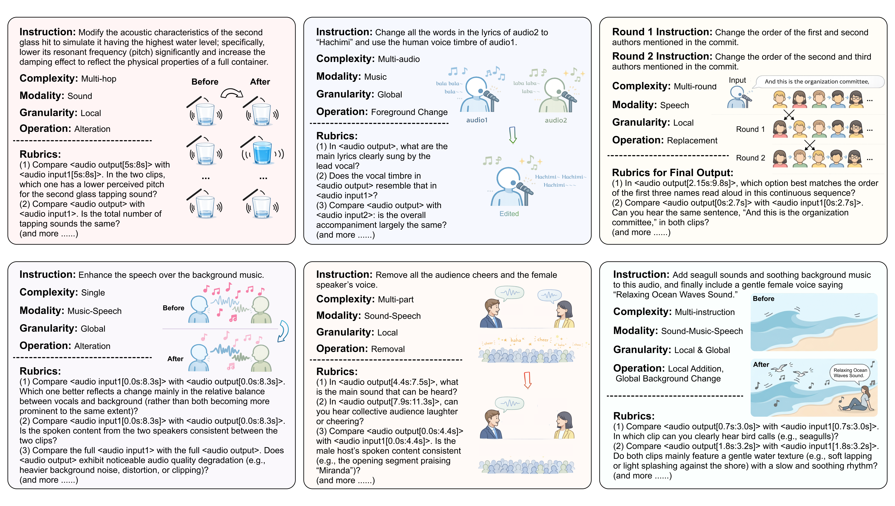
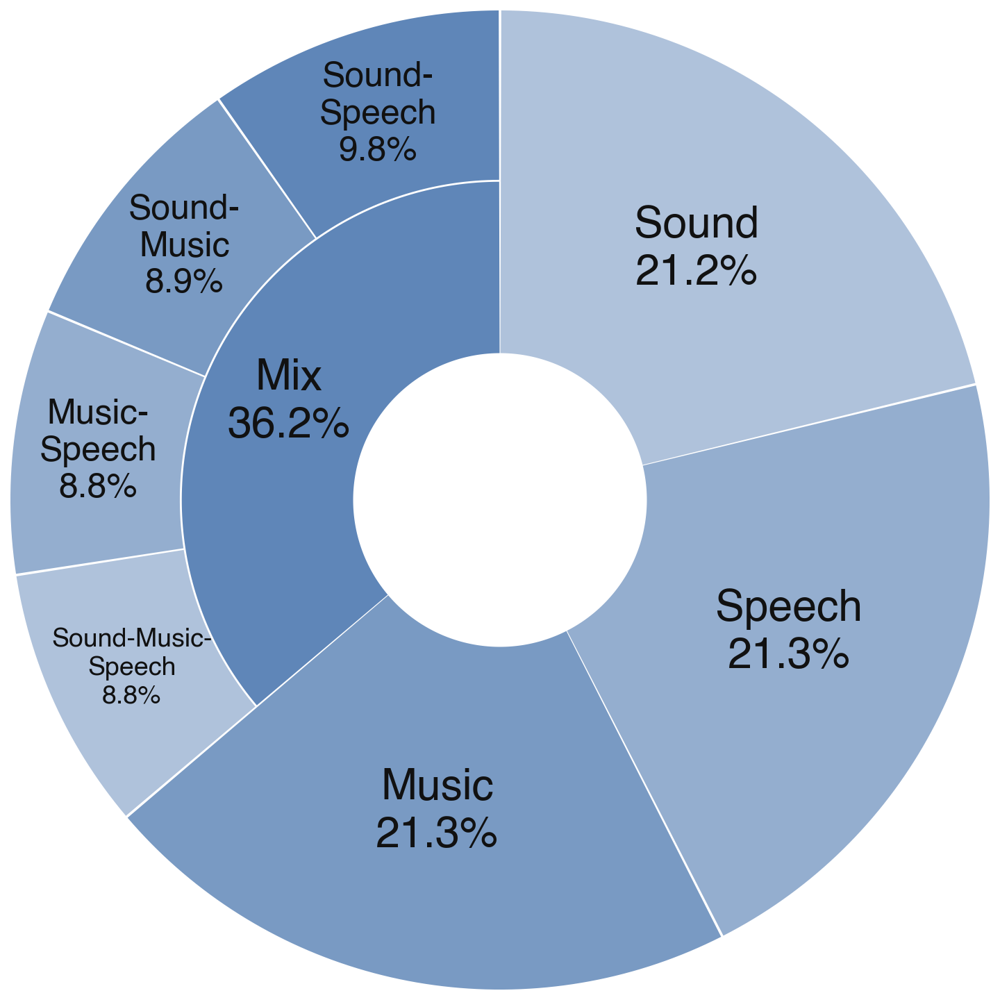
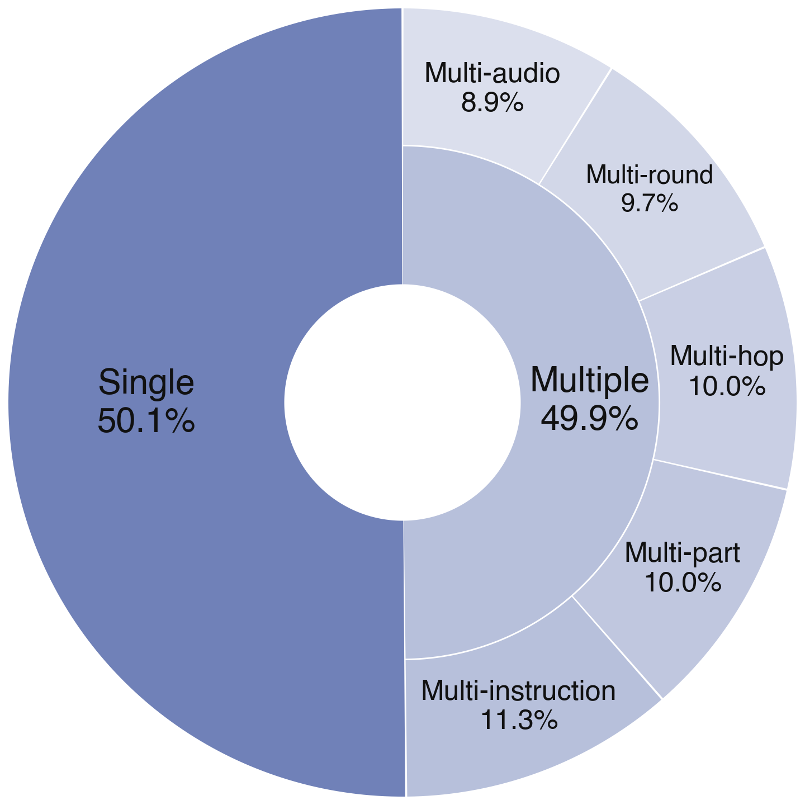
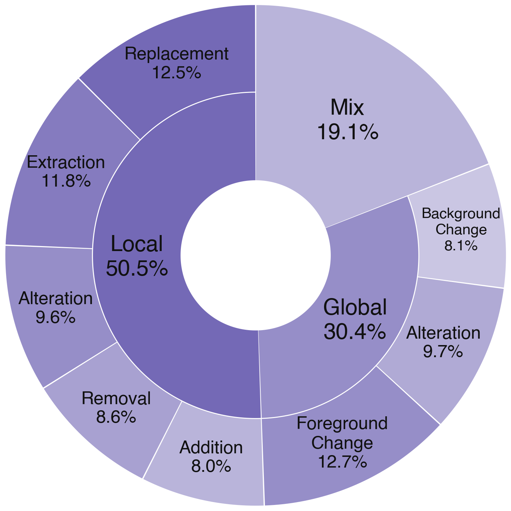
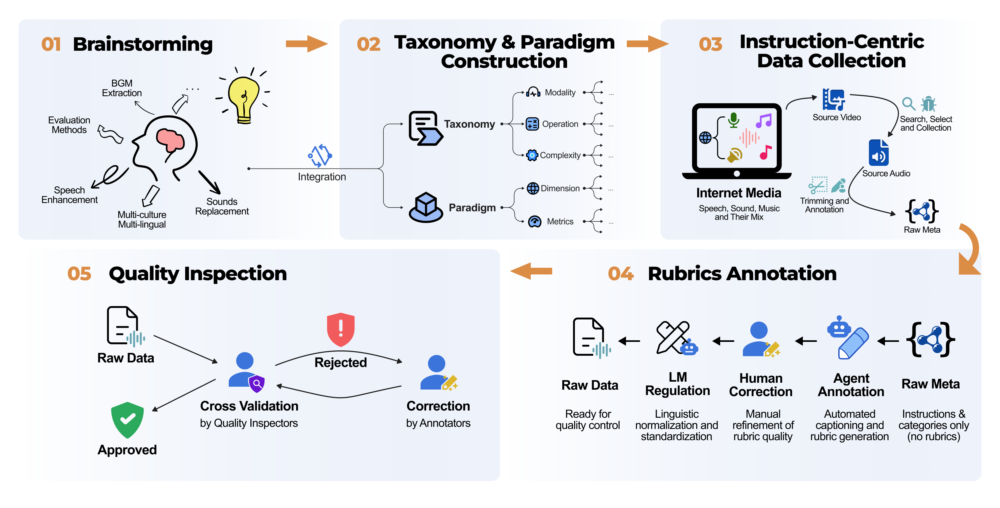

# MMAE: A Massive Multitask Audio Editing Benchmark
[**📖 arXiv**](https://arxiv.org/abs/2606.07229) | [**🎬 MMAE Demo Video**](https://youtu.be/6At5nTWhlXI) | [**🛠️ GitHub Code**](https://github.com/ddlBoJack/MMAE) | [**🔊 HuggingFace Audio Download**](https://huggingface.co/datasets/BoJack/MMAE)

<p align="center"></p>

## Overview of MMAE
We introduce **MMAE**, a **M**assive **M**ultitask **A**udio **E**diting benchmark, serving as the first comprehensive evaluation testbed designed for general-purpose instruction-based audio editing. 
MMAE extends to a broad spectrum of real-world scenarios, encompassing 7 distinct audio modalities, including sound, speech, music, and their mixtures. 
MMAE establish a comprehensive taxonomy spanning 6 levels of task complexity, from basic modifications to multi-hop reasoning and multi-round editing, 2 levels of granularity, and 8 distinct operation types. 
Meticulously curated through human-agent collaboration, MMAE comprises 2,000 high-fidelity samples paired with a pioneering rubric-based evaluation framework. By decomposing free-form tasks into 17,741 verifiable criteria, this robust rubric-based paradigm enables a precise, multi-dimensional assessment of both instruction following and context consistency. 
We hope MMAE will serve as a catalyst for future advances in the intelligent creation community, providing a clear diagnostic roadmap and establishing a standardized, long-lasting evaluation paradigm for next-generation audio editing systems. 

Examples of the MMAE benchmark:



Distribution of the MMAE benchmark across three taxonomy dimensions: modality, difficulty, and operation. 
<p float="left">
  
  
  
</p>

## Data Curation Pipeline
MMAE is constructed through a systematic five-stage pipeline designed to ensure both diversity and high-quality of the benchmark:
1. Brainstorming.
2. Taxonomy & Paradigm Construction.
3. Instruction-Centric Data Collection.
4. Rubrics Annotation.
5. Quality Inspection.


## Evaluation

We use [Qwen3-Omni](https://github.com/QwenLM/Qwen3-Omni) as the judge model to evaluate audio editing outputs against our rubric-based criteria.

### Step 1: Deploy Qwen3-Omni

Clone the official repository and set up the environment following their instructions:

```bash
git clone https://github.com/QwenLM/Qwen3-Omni.git
cd Qwen3-Omni
# Follow the official README to install dependencies
```

Then launch the vLLM serving instances. We provide a reference deployment script [`launch_qwen3_omni.sh`](eval/launch_qwen3_omni.sh).

This starts two Qwen3-Omni instances (tensor-parallel=4 each) on 8 GPUs, serving at ports 8001 and 8002. Edit `MODEL_DIR` in the script to point to your local model weights.

### Step 2: Prepare Predictions

Run your audio editing model on the MMAE benchmark inputs ([meta data](MMAE-meta.json)). Modify the original chatml-format `messages` with an appended `assistant` turn pointing to the output audio path, e.g.,

```json
[
  {
    "id": "69e897fbf1844435bec75eca",
    "messages": [
      {
        "role": "user",
        "content": [
          {"type": "text", "text": "Extract the music component from the audio."},
          {"type": "audio", "audio_url": "wav/69e897fbf1844435bec75eca/audio1.wav"}
        ]
      },
      {
        "role": "assistant",
        "content": [
          {"type": "audio", "audio_url": "your_output_wav_path"}
        ]
      }
    ]
  }
]
```

The `audio_url` paths can be absolute or relative to the predictions file's parent directory (or the `--audio_root` you specify). Save the modified meta data as another JSON file indicating your model's predictions.

### Step 3: Run Evaluation

```bash
python -m eval.score \
  --predictions path/to/your_predictions.json \
  --base_urls "http://localhost:8001/v1,http://localhost:8002/v1" \
  --audio_root path/to/audio_root \
  --output_dir outputs/your_model \
  --concurrency 8
```

**Arguments:**

| Argument | Description |
|----------|-------------|
| `--predictions` | **(required)** Path to your predictions JSON file. |
| `--base_urls` | **(required)** Comma-separated Qwen3-Omni endpoint URLs. |
| `--metadata` | Path to MMAE metadata. Default: `MMAE-meta.json`. |
| `--audio_root` | Base directory for resolving relative audio paths. Default: parent directory of predictions file. |
| `--output_dir` | Where to write results. Default: `outputs/scores`. |
| `--concurrency` | Number of samples scored in parallel. Default: 16. |
| `--retries` | Number of valid judge responses to collect per rubric. Should be 3. |
| `--max_attempts` | Max total attempts (including failures) per rubric. Default: 10. |
| `--timeout` | Timeout in seconds per judge request. Default: 300. |
| `--model` | Model name served by vLLM. Default: `Qwen3Omni-Instruct`. |

**Output files** (written to `--output_dir`):

| File | Description |
|------|-------------|
| `results.jsonl` | Per-rubric detailed results: each rubric's 3 judge responses, per-attempt choices, scores, and raw model outputs. |
| `per_sample.json` | Per-sample aggregated scores: Instruction Following Rate, Consistency Rate, and Exact Match Rate for each data entry. |
| `taxonomy.json` | Scores grouped by modality, complexity, cross dimensions, and operation type. |
